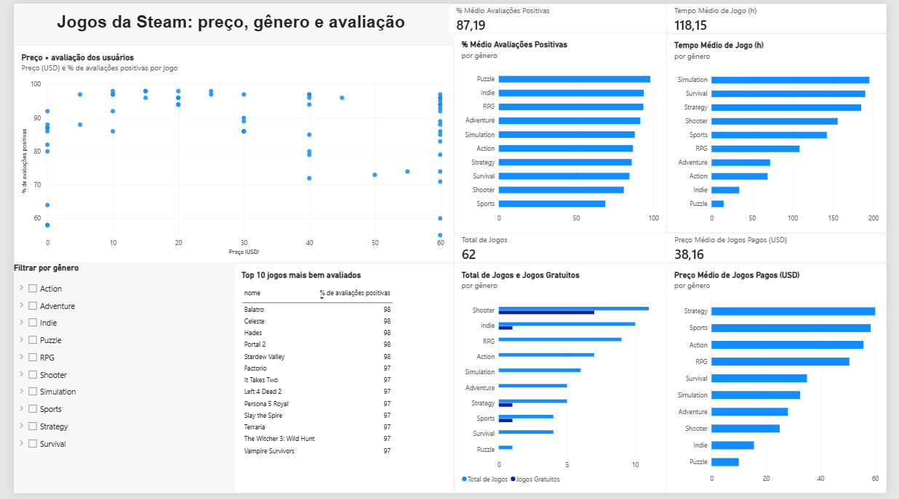

# Análise de Dados: Jogos da Steam

Projeto de análise exploratória de dados feito para praticar limpeza de dados, agregações e visualização, com um tema que faz parte do meu interesse pessoal: jogos. A análise foi feita em duas etapas: primeiro em **Python (Pandas e Matplotlib)** e depois em um **painel interativo no Power BI**, usando os mesmos dados da plataforma Steam.

## Painel no Power BI



O painel traz:

- Cartões-resumo: 62 jogos, preço médio de US$ 38,16 entre os jogos pagos, 87,19% de avaliações positivas e 118,15 horas de tempo médio de jogo
- Gráficos por gênero: total de jogos (com os gratuitos em destaque), preço médio dos jogos pagos, avaliação média e tempo médio de jogo
- Dispersão de preço × avaliação dos usuários
- Top 10 jogos mais bem avaliados
- Filtro por gênero, que atualiza todo o painel

Arquivo: [`steam_dashboard.pbix`](steam_dashboard.pbix)

## O que o projeto faz

- Carrega um dataset com 62 jogos conhecidos da Steam (gênero, preço, ano de lançamento, % de avaliações positivas, tempo médio de jogo)
- Responde perguntas de análise:
  - Qual gênero é mais comum na base?
  - Qual o preço médio por gênero (considerando só os jogos pagos)?
  - Existe correlação entre preço e nota de avaliação?
  - Quais são os 10 jogos mais bem avaliados?
  - Quantos jogos são gratuitos vs pagos?
  - Qual gênero prende mais o jogador (tempo médio de jogo)?
- Gera 3 gráficos (.png) com Matplotlib para visualizar os resultados
- Reproduz e amplia a análise em um painel interativo no Power BI

## Principais descobertas

- Shooter é o gênero com mais jogos na base, seguido de Indie e RPG
- Entre os jogos pagos, Strategy, Sports e Action têm os maiores preços médios; Indie e Puzzle, os menores
- Ao incluir os jogos gratuitos, o preço médio de Shooter cai bastante, porque vários dos jogos mais conhecidos do gênero na base (como Counter-Strike 2, Team Fortress 2 e Apex Legends) não custam nada
- A correlação entre preço e % de avaliações positivas é praticamente nula (≈ -0.06), ou seja, preço não é um bom preditor de qualidade percebida. No painel, isso aparece como jogos bem avaliados em todas as faixas de preço
- Puzzle, Indie e RPG têm as melhores avaliações médias; Sports tem a menor
- Simulation, Survival e Strategy têm o maior tempo médio de jogo, o que faz sentido dado o caráter de longo prazo desses gêneros

## Ajuste de dados feito no Power BI

Ao importar o CSV, os preços apareceram multiplicados por 100 (por exemplo, 29.99 virou 2999), porque o Power BI em português lê o ponto como separador de milhar. Corrigi definindo o tipo da coluna `price_usd` como número decimal com a localidade Inglês (Estados Unidos).

Também criei medidas em DAX (total de jogos, médias, preço médio dos jogos pagos e jogos gratuitos) e uma coluna calculada separando jogos gratuitos e pagos.

## Como rodar a análise em Python

```bash
pip install pandas matplotlib
python analise_steam.py
```

## Sobre os dados

O dataset completo da Steam tem mais de 80 mil jogos e passa de 100MB, então preferi montar uma versão menor com cerca de 60 jogos conhecidos para focar na lógica da análise sem me perder no tamanho do arquivo. O código funciona do mesmo jeito com uma base maior, é só trocar o `steam_games.csv` por um dataset completo (tem um bom no [Kaggle](https://www.kaggle.com/datasets)) mantendo as mesmas colunas.

**Limitações:** a base é pequena e não é uma amostra aleatória (são jogos conhecidos), e alguns gêneros têm pouquíssimos jogos (Puzzle tem apenas 1). Por isso, as conclusões por gênero mostram tendências desta base e não devem ser generalizadas para toda a Steam.

## Tecnologias usadas

- Python 3
- Pandas
- Matplotlib
- Power BI (DAX)

---
Projeto feito por Matheus Souza como parte do portfólio de estudos.
